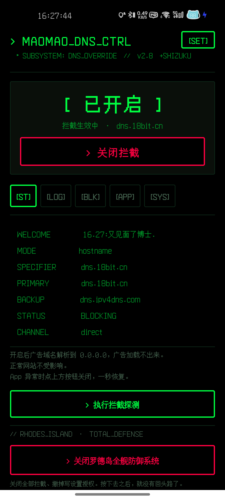
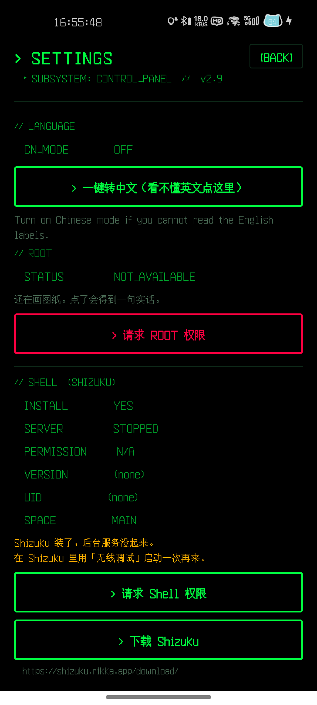
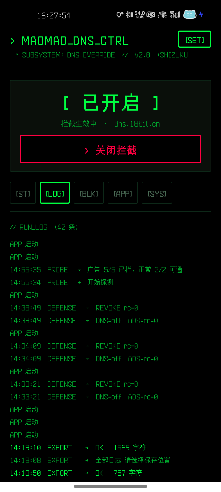
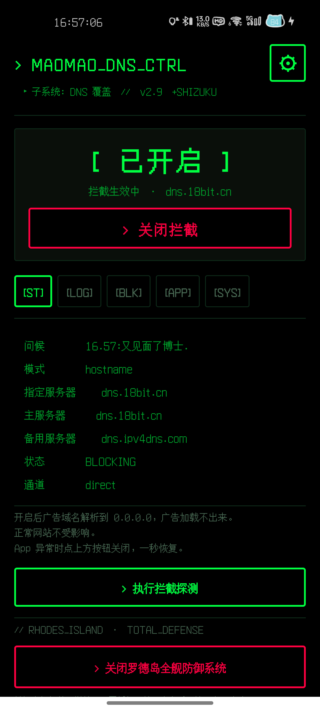

<div align="center">

# 普瑞赛斯病毒

**Android 私人 DNS 广告拦截 · Shizuku 命令通道 · 终端风格界面**

`v3.1` · `versionCode 18` · Android 7.0+ · 193 KB

[**⬇ 下载 APK**](https://github.com/mnbvcxz424/prts-virus/releases/latest) &nbsp;·&nbsp; [使用说明](#使用说明) &nbsp;·&nbsp; [常见问题](#常见问题)

</div>



## 它是什么

一个手机上的**私人 DNS 开关**。开启后广告域名被解析到 `0.0.0.0`，广告加载不出来；正常网站不受影响。

界面是绿色终端风格，全部功能分五个页签：`[ST]` 状态、`[LOG]` 运行日志、`[BLK]` 拦截日志、`[APP]` 应用规则、`[SYS]` 系统。

## 功能

| 功能 | 说明 |
|---|---|
| **一键开关** | 主页一个大按钮，开了就是开了，关了就是一秒恢复 |
| **双通道** | 能走系统设置就走系统设置，走不了就借 Shizuku 的 `settings` 命令 |
| **拦截探测** | 当场解析 5 个广告域名 + 2 个正常域名，直接看到效果 |
| **运行日志** | 每一次开关、探测、导出都留痕，42 条起步 |
| **日志导出** | 通过系统文件选择器存成 TXT，不需要存储权限 |
| **应用规则** | 按 App 单独设置，无障碍服务实现 |
| **中文模式** | 设置页一键切换，英文标签全变中文 —— 看不懂英文也能用 |
| **多 DNS 切换** | 内置 5 个私人 DNS（去广告 / 不过滤），实测切换即时生效 |
| **拦截统计** | 记录探测次数和累计拦截条数，一眼看出拦了多少 |
| **广告 SDK 扫描** | 走 Shizuku 扫已装 App 里嵌的推广 SDK（穿山甲 / 优量汇 / 友盟 / 极光 / OPPO 推广等） |
| **本地拦截（VPN）** | 本地 VpnService 拦 DNS —— **只接管 DNS，其他流量不进 VPN**；带真实查询数/拦截数/拦截率统计 |
| **彩蛋** | 主界面最下面那个红框按钮 …… 按下去就没有回头路了 |

## 界面

| 设置页 | 运行日志 |
|---|---|
|  |  |

### 中文模式

右上角齿轮 → 设置 → 语言 → 一键转中文。英文标签会全部换成中文，随时可以切回去。



## 能拦什么，拦不住什么

| 类型 | 能不能拦 |
|---|---|
| 网页广告（域名级别） | ✅ 能 |
| 追踪统计（Google Analytics 之类） | ✅ 能 |
| App 里的图片广告（独立域名） | ✅ 多数能 |
| App 开屏广告（和内容同域名） | ❌ 拦不住 |
| 视频贴片广告（同域名内嵌） | ❌ 拦不住 |
| 系统推送广告 | ❌ 拦不住 |

私人 DNS 只能按**域名**拦，网站自家的推广位和域名是同一个，DNS 层看不见区别 —— 这点得说实话。

## 安装

1. 打开 [Releases](https://github.com/mnbvcxz424/prts-virus/releases/latest)，下载 `.apk`
2. 手机上点开安装（要允许「安装未知应用」）
3. 打开后进右上角**齿轮 ⚙**，先把**使用说明**那六段读完；看不懂英文就点「一键转中文」

## 使用说明

- 没有 root 的手机，系统预装的推广 SDK 关不掉，只能压制
- 开启拦截后，少数 App 的图片、视频、登录可能加载异常 → 关掉拦截一秒恢复
- 部分 Android 版本不允许普通应用改私人 DNS，这时需要 Shizuku 通道
- 多用户环境下（比如分空间、岛上应用）授权只在主空间有效，设置页会显示 `SPACE` 那一行提醒

## 关于 Shizuku

[Shizuku](https://shizuku.rikka.app/) 用无线调试拿到 shell 权限，让普通应用也能执行系统命令。

本应用用它做两件事：改私人 DNS、给需要的权限。

设置页会显示 Shizuku 的实时状态（安装 / 服务 / 授权 / 版本 / UID / 空间），服务没起来的时候会提示你去 Shizuku 里用「无线调试」启动一次。

## 常见问题

<details>
<summary><b>开启后某个 App 打不开了怎么办</b></summary>

回到主页点「关闭拦截」。DNS 是全局的，一秒恢复，不用重启。
</details>

<details>
<summary><b>为什么我的私人 DNS 改不了</b></summary>

大部分国产 ROM 不允许普通应用写这个设置。装 Shizuku，在设置页点「请求 Shell 权限」。
</details>

<details>
<summary><b>日志在哪</b></summary>

`[LOG]` 页签里，右上角可以导出成 TXT。导出走系统文件选择器，不申请存储权限。
</details>

## 构建

没有用 Gradle，全部手动调 SDK 工具链：

```powershell
# 1. 先给签名密码（不存在脚本里）
set DNSAPK_KS_PASS=你的 keystore 密码

# 2. 构建
powershell -ExecutionPolicy Bypass -File build-v6.ps1
```

脚本会依次跑：`aapt2 compile` → `aapt2 link` → `javac` → `d8` → 注入 dex → `zipalign` → `apksigner`。

需要：Android SDK build-tools 34、`android.jar`（platform 34）、JDK 17。脚本顶部的路径按自己机器改。

`libs/` 里是 Shizuku 的四个 jar（api / provider / shared / aidl），来源和许可见 [libs/README.md](libs/README.md)。

## 隐私

- 不联网，不上报，不收集
- 日志只存在本机，导出位置由你选
- 唯一的网络行为是 DNS 解析本身，以及探测时的几次解析

## 说明

个人自用工具，按现状提供，不保证适配所有机型。

签名私钥不在仓库里，只由作者持有 —— 这也意味着**别人不能给你签名更新包**，装了就认这个作者。
